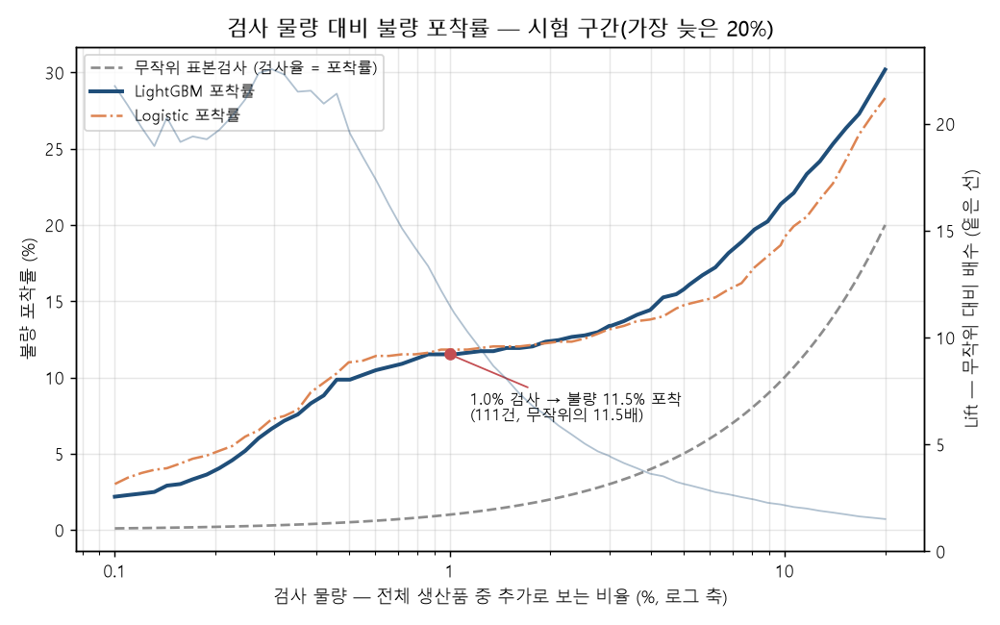
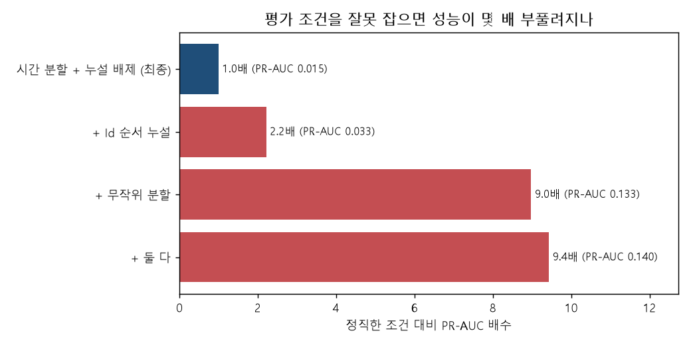
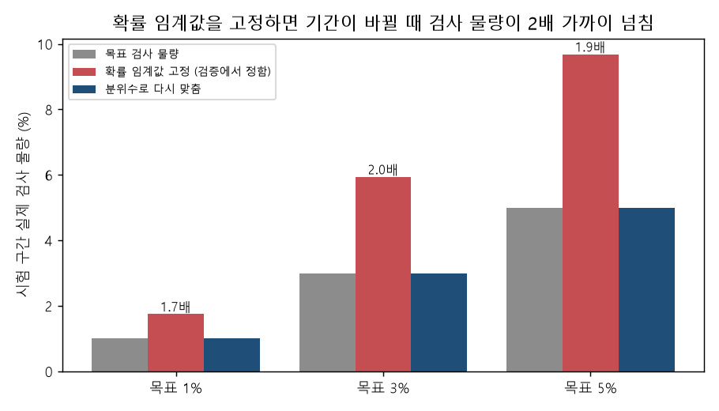
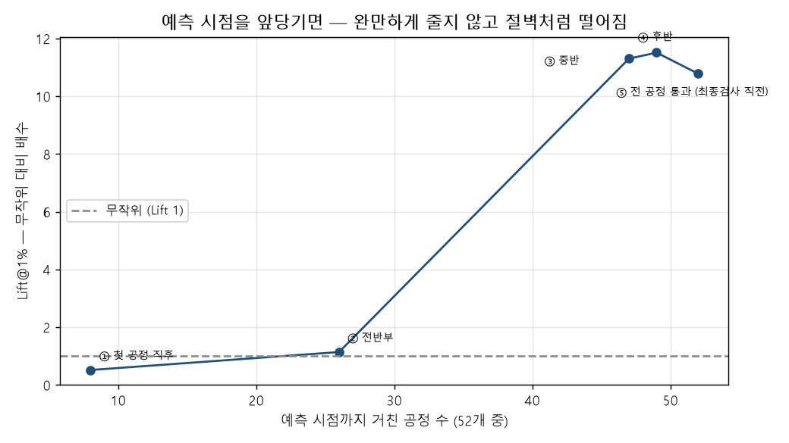
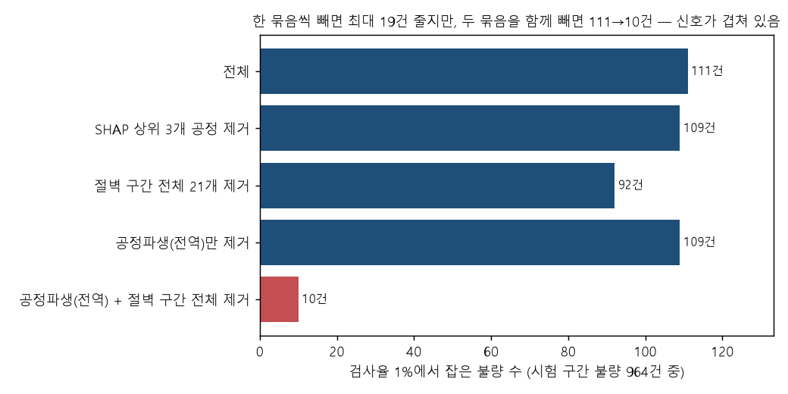
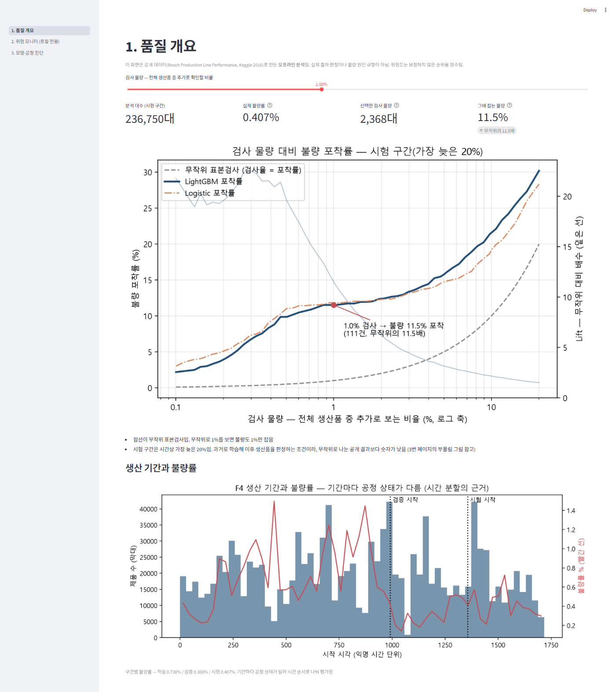

# 제품 1%만 추가 검사해 불량 11.5%를 찾기 — 제조 공정 품질 Risk Monitoring

> 생산라인을 다 지난 제품을 공정 기록으로 줄 세워, 품질 담당자가 **추가 검사할 1%를 어디에 쓸지** 정하는 분석. Bosch 공개 생산 데이터(제품 118만 대, 불량 0.58%)로 만들었음.
>
> 결과와 판단 과정을 3분 안에 읽도록 줄인 문서임. 실행 방법은 [`README.md`](../README.md), 쓸 수 있는 곳과 한계는 [`MODEL_CARD.md`](../MODEL_CARD.md) 에 있음.

---

## 1. 풀려는 문제

불량률이 0.58%인 라인에서는 모든 제품을 양품이라고 해도 정확도가 99.4%임. "이 제품이 불량인가"를 맞히는 정확도로는 쓸모를 판단할 수 없음.

현장에서 실제로 정해야 하는 것은 이것임.

> **오늘 추가로 전체 제품의 1%를 더 볼 수 있다면 어느 1%를 볼 것이며, 그러면 불량의 몇 %를 잡게 되나**

그래서 평가 기준을 **검사 물량 대비 불량 포착률**과 **무작위 표본검사 대비 배수**로 정했음. 무작위로 1%를 뽑으면 불량도 1%를 잡으므로, 배수는 곧 "같은 검사 인원으로 몇 배 더 잡는가"임.

---

## 2. 결과

| 검사율 | 검사 대수 | 잡은 불량 | 포착률 | 무작위 대비 |
|---|---|---|---|---|
| 0.5% | 1,184 | 95 | 9.85% | 19.7배 |
| **1%** | **2,368** | **111** | **11.51%** | **11.5배** |
| 5% | 11,838 | 152 | 15.77% | 3.2배 |
| 10% | 23,675 | 208 | 21.58% | 2.2배 |

- 시험 구간은 시간순으로 가장 늦은 20%(제품 236,750대, 불량 964건)임. 과거 데이터로 학습해 그 뒤에 생산된 제품을 판정한 숫자임
- 검사율 1% 포착률의 95% 구간은 **8.6~15.4%** 임. 하루 단위로 날짜를 다시 뽑아(블록 부트스트랩) 계산했음
- 이 숫자는 **"하루가 끝나면 그날 생산분에서 상위 1%를 골라 추가 검사한다"** 는 운영에서 성립함. 하루 단위로 다시 재도 106건으로, 111건과 구분되지 않았음(3절 ②)
- 뽑힌 2,368대 중 불량은 111대(정밀도 4.7%)임. 출하 판정에는 쓰지 않고 **추가 검사 대상을 고르는 데까지만** 씀

예측 모델은 트리 모델(LightGBM)과 선형 모델(Logistic 회귀) 두 가지를 비교했음. 검사율 1%에서 둘의 차이는 −10 ~ +3건(95% 구간)으로 구분되지 않았음. Logistic 은 입력을 공정별 요약값 265개로 줄여서 썼으므로 완전히 같은 조건의 비교는 아님. 어느 모델을 고르느냐로는 결과가 달라지지 않았고, 결과를 좌우한 것은 아래 판단들임.

---

## 3. 숫자를 믿을 수 있게 만든 판단 네 가지

### ① 공개된 결과보다 낮은 숫자를 택함 — 평가 조건을 잘못 잡으면 PR-AUC가 9배로 부풀려짐

PR-AUC 는 불량을 위에서부터 얼마나 잘 줄 세우는지 보는 종합 점수임.

- **상황**: 착수 전에는 1%에서 20~35%를 잡을 것으로 예상했는데 11.5%가 나왔음
- **확인한 것**: 같은 데이터와 모델, 입력에서 분할만 무작위로 바꾸면 PR-AUC가 9배가 됨. 핵심 지표인 1% 포착률로는 약 2.2배(25.89% ÷ 11.51%)이고, 시험 구간 불량률 차이를 보정하면 PR-AUC 로도 약 6.3배임. 기간마다 불량률이 0.31~0.83%로 달라서 생기는 차이임(시작 시각 5등분 기준)
- **또 확인한 것**: 제품 Id 순서에 정답이 새고 있었음. 앞 번호 제품이 불량이면 불량률이 9.4배였는데, Id와 생산 시각의 상관은 0.002로 Id가 시간순도 아니었음. 이 값을 넣으면 PR-AUC가 2.2배, 1% 포착률이 약 1.3배로 부풀려짐
- **판단**: 공개된 Bosch 결과는 대부분 무작위 분할임. 실제 운영은 과거로 학습해 이후 제품을 판정하므로, 시간순으로 나누고 Id 계열 입력을 뺀 낮은 숫자를 최종으로 택했음. 학습을 일찍 멈춘 탓이나 입력이 모자란 탓인지도 따로 확인함. 학습 라운드를 7배로 늘리면 오히려 나빠졌고, 공정에서 뽑은 입력 65개만으로도 원본 측정값 968개를 쓴 것과 같은 성능이 나왔음

### ② 점수 문턱값을 미리 정해 두면 검사 물량이 2배 가까이 넘침

- **상황**: 검증 구간에서 "상위 1%가 되는 점수"를 정해 시험 구간에 그대로 쓰면 실제 검사 물량이 1.75%가 됨. 3% 목표는 5.94%, 5% 목표는 9.68%가 됨. 기간마다 불량률이 달라 점수 분포가 움직이기 때문임
- **처음 생각**: 대표 숫자 111건은 시험 구간 5개월치를 한 번에 줄 세운 것임. 현장처럼 날마다 끊어서 고르면 무너질 수 있다고 봤음
- **확인한 것**: 운영 방식별로 다시 쟀음(검사율 1%)

| 운영 방식 | 실제 검사율 | 잡은 불량 | 같은 대수를 전체 순위로 뽑았다면 |
|---|---|---|---|
| 5개월치를 한 번에 줄 세움 (대표 숫자) | 1.00% | 111 | 111 |
| 하루 마감 후 그날 생산분에서 상위 1% | 1.03% | 106 | 111 |
| 전날 기준 점수로 나오자마자 판정 | 2.22% | 120 | 121 |

- **판단**: 하루 단위로 골라도 대표 숫자는 유지됨(차이의 95% 구간 −2 ~ +13건). 즉시 판정은 120건으로 더 잡은 것처럼 보임. 그러나 같은 물량을 순위대로 뽑으면 121건이라, 잡는 능력은 같고 검사 물량만 늘어난 것임. 검사 물량이 34%까지 치솟는 날도 있었음. 그래서 권하는 운영을 "하루 마감 후 상위 1%"로 정했음
- 데이터에 시간 단위가 적혀 있지 않음. 제품 수가 반복되는 주기(2.4단위, 16.8단위)를 보고 하루와 1주로 추정했음 `[추정]`

### ③ 조기 경보로는 쓸 수 없다고 범위를 좁힘

- **상황**: 공정 초반에 미리 걸러 내면 가치가 더 크므로, 공정을 몇 개까지 지났을 때 예측이 되는지 쟀음
- **확인한 것**: 곡선이 완만하게 오르지 않고 절벽처럼 꺾였음. 공정 26개(전체 52개 중)까지는 무작위 수준(1.1배)이었고, 47개에서 11.3배로 전 공정을 다 본 경우(10.8배)와 같은 수준이 됨
- **판단**: 이 모델은 "라인을 다 지난 제품의 검사 우선순위"에만 쓰고, 조기 경보라고 말하지 않기로 함

### ④ "이 공정이 원인"이라고 말하지 않음 — 신호가 두 곳에 겹쳐 있음

입력 묶음을 빼고 다시 학습해, 잡은 불량이 얼마나 줄어드는지 봤음(ablation).

| 다시 학습한 조건 | 잡은 불량 |
|---|---|
| 전체 | 111 |
| 기여도(SHAP) 상위 3개 공정 제거 | 109 |
| ⓐ 절벽 구간 공정 21개 제거 | 92 |
| ⓑ 구조값 13개 제거 | 109 |
| **ⓐ와 ⓑ 모두 제거** | **10 (무작위 수준)** |

구조값은 시작 시각, 소요 시간, 경로 번호처럼 특정 공정에 속하지 않고 제품 전체 이동 과정을 나타내는 값 13개임. SHAP 은 입력마다 점수에 얼마나 기여했는지 나눠 보는 계산임.

- **상황**: 기여도 순위가 나오면 "이 공정을 관리하라"고 쓰고 싶어짐
- **확인한 것**: SHAP 상위 3개 공정을 빼도 2건만 줄었음. 구조값만 빼면 −2건, 절벽 구간 공정만 빼면 −19건으로 일부 줄었고, 둘을 함께 빼야 −101건으로 무너졌음. 한쪽이 빠지면 다른 쪽이 상당 부분 대신하는 구조임
- **판단**: 공정 순위는 "모델이 판단할 때 본 곳"으로만 쓰고, 원인이나 결정적 공정이라고 하지 않음. 한 묶음씩만 빼 봤다면 어느 쪽도 꼭 필요하지 않다는 틀린 결론이 나왔을 것임. 조기예측 곡선이 절벽 모양인 것도 이것으로 설명됨. 공정 초반에는 두 신호가 모두 아직 없음

---

## 4. 처음 판단이 틀렸다가 고친 것

| 처음 판단 | 무엇으로 알았나 | 고친 것 |
|---|---|---|
| 변환본 크기 4.6GB | 실제 변환 결과 1,012MB | 4.6GB는 메모리에 올렸을 때의 크기였음. 디스크 파일은 열 단위로 압축되고 결측이 82.7%라 1GB로 줄어듦. 서로 다른 것을 재는 두 값을 하나로 적은 실수 |
| 공정 순서를 공정별 날짜 중앙값으로 추정 | 제품 3.29%만 지나는 공정이 1번으로, 방문 제품이 1대인 공정이 2번으로 올라옴 | 그 날짜에는 공정 순서보다 "그 제품이 생산된 시기"가 담겨 있었음. 제품 안에서의 상대 시각으로 바꾸고, 옛 방식으로 되돌리면 실패하는 회귀 테스트를 넣음 |
| 잡은 불량이 앞 시기에 몰렸으니 재학습 주기를 짧게 | 잡은 불량의 시기별 **비중**을 포착률처럼 읽었음 | 시기별 포착률로 다시 계산하니 19.2 / 13.2 / 10.8 / 3.9 / 8.8%로 꾸준히 떨어지지 않았음. 구간 폭으로 보아 재학습 주기 실험은 하지 않기로 함 |
| 즉시 판정이 더 많이 잡는다(120 > 111건) | 검사 물량이 2.22%로 두 배 넘게 달랐음 | 같은 물량끼리 비교하는 열을 표에 넣음. 물량이 다른 방식끼리는 잡은 건수를 바로 비교하지 않음 |

결측 처리는 처음 가설이 맞았음. "측정값이 비어 있으면 그 공정을 지나지 않은 것"이라는 가설을, 측정값 결측과 날짜 결측이 같은 칸에서 일어나는지 맞춰 봐서 확인했음(59,187,350칸 중 불일치 3칸). 그래서 결측을 평균으로 채우지 않고 "어느 공정을 지났나"를 그대로 입력으로 씀.

---

## 5. 쓰면 안 되는 곳과 한계

- **출하 판정이나 불량 확정**에 쓰지 않음. 뽑힌 제품의 95% 이상이 양품임
- **조기 경보**에 쓰지 않음(3절 ③)
- **불량 원인 규명**에 쓰지 않음(3절 ④)
- 점수는 보정하지 않았으므로 **확률로 읽으면 안 됨**
- 시험 구간 하나를 여러 분석에 썼음. 손대지 않은 다음 기간 데이터가 없어 이 영향을 따로 잴 수 없고, 숫자가 약간 낙관적일 수 있음 `[추정]`
- 95% 구간은 날짜를 다시 뽑아 낸 것이라 **모델을 다시 학습할 때의 흔들림은 들어 있지 않음**
- Bosch 공개 데이터 한 벌로 만든 결과임. 실제 공장 데이터나 다른 제품군에서는 확인하지 않았음

---

## 6. 직접 확인하는 방법

- 저장소를 받아 패키지를 설치하고 `streamlit run app/main.py` 를 실행하면, 원본 데이터 없이도 **품질 개요 화면과 모델 진단 화면**이 뜸. 결과 집계표 25개와 그림 11장이 저장소에 들어 있음
- 원본 데이터는 대회 규정상 재배포가 금지라 저장소에 없음. Kaggle에서 각자 규정에 동의하고 받은 뒤 README 1-2절 순서대로 돌리면 같은 표가 나옴. 새 폴더에 처음부터 받아 다시 돌려 봤고, 소요 시간 칸과 예전에 낡아 있던 Dummy 기준선 행을 빼면 결과가 같았음
- 테스트는 142개임. 통과만으로는 믿을 수 없어서, 일부러 코드를 망가뜨려 테스트가 실제로 실패하는지도 확인했음
- 제품 한 대씩의 위험도 목록 화면은 원본에서 나온 값이라 공개하지 않음

---

## 7. 일부러 하지 않은 것

하이퍼파라미터 탐색, XGBoost 같은 모델 추가, 딥러닝, MLflow, API 서버, 범주형 입력 2,140개, 불균형 데이터 오버샘플링(SMOTE)은 하지 않았음.

모델을 바꿔도 1%에서 구분되지 않는다는 것을 먼저 확인했음. 그래서 남은 시간은 모델 성능을 올리는 데 쓰지 않고, **이 숫자가 운영에서 성립하는 조건**을 확인하는 데 썼음.

---

## 개정 이력

| 날짜 | 고친 곳 | 원래 내용 | 바꾼 내용 | 왜 바꿨나 |
|---|---|---|---|---|
| 2026-10-30 | 재현 절 테스트 수 | 117개 | 142개 | 화면 시안 구현으로 화면 테스트가 늘었음(PR #1 에서 이미 119개였는데 고치지 않았음). 화면 캡처 그림은 아직 옛 화면이라 다음에 다시 찍어야 함 |
| 2026-10-20 | 제목, 2절, 3절 ①③④, 6절, 용어 설명 | 제목 "검사 인력 1%", 2절의 "(4절 ②)", ① 제목 "9배 부풀려짐", ④ "한 묶음씩만 빼면 거의 그대로", ③ "47개에서 전 공정 수준(11.3배)", 재현 조건 "소요 시간 칸을 빼고", PR-AUC·SHAP·부트스트랩 설명 없음 | 제목을 "제품 1%"로, 절 번호를 3절 ②로, ① 제목에 PR-AUC 기준임을 밝히고 1% 포착률 2.2배와 보정 6.3배를 덧붙임, ④에 −2·−19·−101건을 그대로 적고 ⓐⓑ 표시와 구조값 설명을 넣음, ③을 "47개에서 11.3배, 전 공정 10.8배와 같은 수준"으로, 재현 조건에 Dummy 행, Logistic 입력이 다르다는 단서, 용어 한 줄 설명. 가운뎃점과 "A가 아니라 B" 문장을 풀어 씀 | 커밋 전에 맥락 없는 검토 에이전트가 원자료와 대조해 10건을 지적함. 숫자 자체는 모두 맞았지만, 9배를 핵심 지표(1% 포착률)의 배수로 읽게 만드는 제목과 −19건을 "거의 그대로"로 뭉갠 문장은 근거보다 센 표현이었음. 이 두 가지는 모델카드에서 10-19에 이미 바로잡은 표현인데 초안에 다시 들어갔음. "검사 인력"은 사람 수로 읽혀 검사 물량과 뜻이 달랐음. 문체는 AI 티 점검(del-ai-st)에서 가운뎃점 남용과 부정 대구 반복이 걸려 고침 |
| 2026-10-20 | 최초 작성 | — | — | README 는 재현 설명서라 길고, 채용 검토자가 짧은 시간에 "무엇을 판단했나"를 읽을 문서가 없었음. 설계 1차 12절 W6 의 "포트폴리오 페이지"를 저장소 안 md 한 장으로 만들기로 사용자가 정함 |
